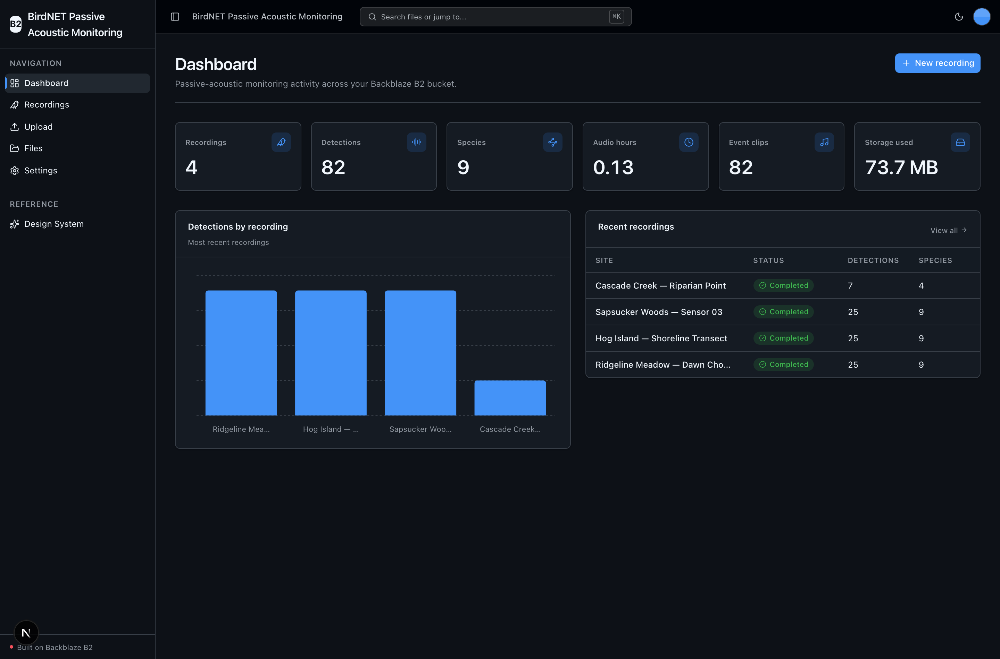
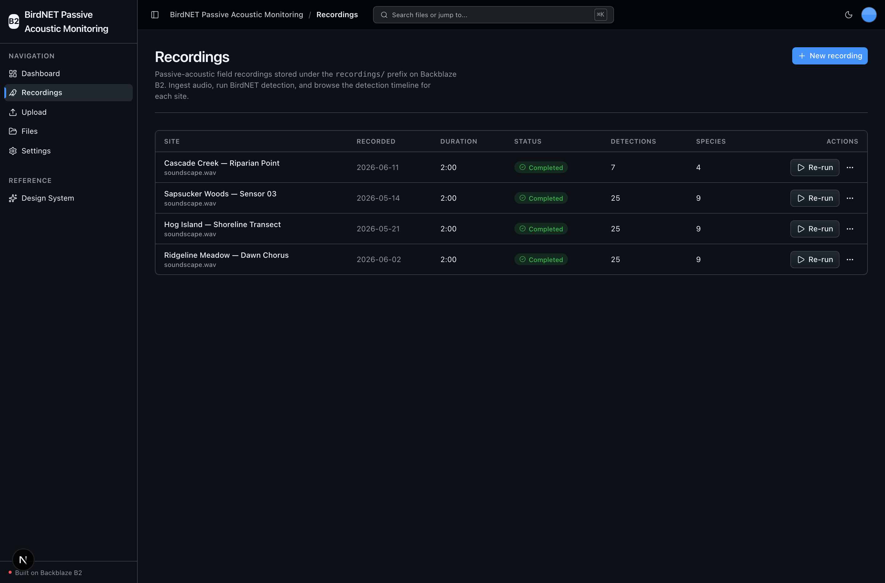
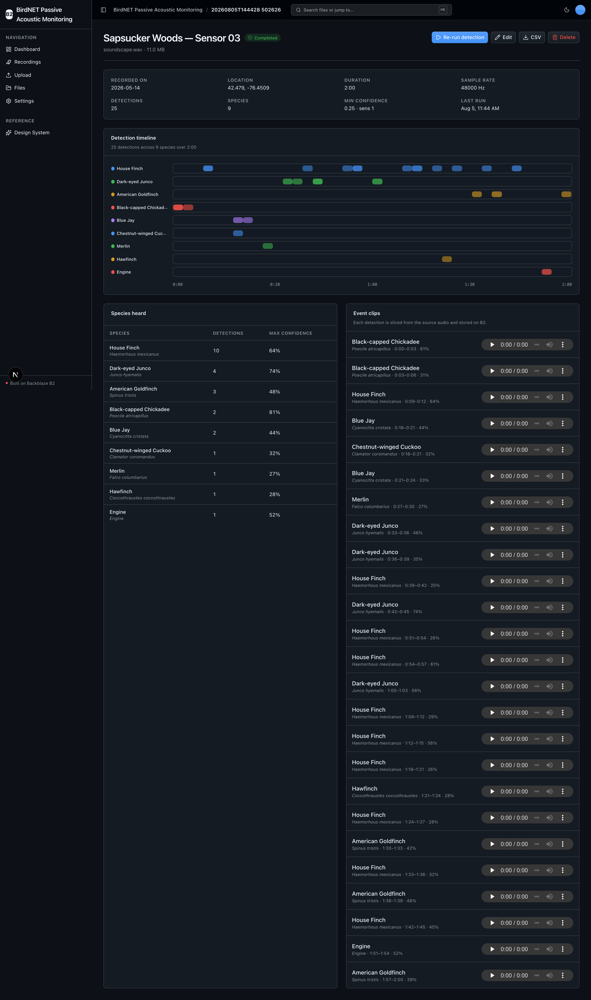

<!-- last_verified: 2026-08-05 -->
# BirdNET Passive Acoustic Monitoring

Detect and clip bird vocalizations in continuous field recordings, stored on
**[Backblaze B2](https://www.backblaze.com/sign-up/ai-cloud-storage?utm_source=github&utm_medium=referral&utm_campaign=ai_artifacts&utm_content=b2ai-birdnet-passive-acoustic-monitoring)**.
Upload a passive-acoustic recording (WAV/FLAC), run the official on-device
**BirdNET-Analyzer** engine, and browse a per-recording **detection timeline** of which
species were heard and when — with every artifact (detections JSON/CSV, event clips)
written back to B2.

This is a full-stack sample built on Backblaze's vibe-coding starter kit: a
TypeScript + Python monorepo with a dashboard UI, a full-bucket file explorer, and a
FastAPI backend with strict layered architecture and structural tests.

**What it does:**
- **Ingest** continuous field recordings + survey metadata (site, lat/lon, date) to
  `recordings/<id>/` on B2 — sustained raw-audio landing in object storage.
- **Detect** bird species/sound events on-device with kahst/birdnet-team's official
  `birdnet-analyzer` (BirdNET GLOBAL 6K V2.4 model — auto-downloads once (~224 MB) on
  the first detection, then cached locally; no API key; CPU by default). No second API
  key: **B2 credentials are the only secret.**
- **Clip** an event-aligned WAV per detection back to B2 (`recordings/<id>/clips/`) —
  the write-amplification a PAM pipeline produces.
- **Timeline** every detection over the recording duration, grouped/colored by species,
  with a species summary and inline clip playback via B2 presigned URLs.

## What it looks like

**Dashboard** — passive-acoustic metrics (recordings, detections, species, audio-hours, event clips, storage used), a detections-by-recording chart, and a recent-recordings table.



**Recordings** — the survey library of every field recording under the `recordings/` prefix on B2, with its survey date, duration, detection and species counts, and a re-run control.



**Detection timeline** — a per-recording view: a species-colored detection timeline across the recording, a species summary with scientific names and max confidence, and event clips streamed from B2 presigned URLs.



## Why Backblaze B2

Passive-acoustic monitoring is a storage-heavy workload: recorders produce hours of raw
audio continuously, and analysis multiplies each raw file into detection tables and many
small event clips. B2 is the single durable layer for all of it — raw `source/` audio,
`meta.json`, `detections.json` + `detections.csv`, and every `clips/*.wav` — accessed
through the S3-compatible API with presigned URLs for in-browser playback.

## Detection engine & model license

Detection uses the **official** `birdnet-analyzer` package from kahst/birdnet-team (the
BirdNET-Analyzer project) — not the third-party `birdnetlib` wrapper. It runs the
**BirdNET GLOBAL 6K V2.4** model, which `birdnet-analyzer` auto-downloads once (~224 MB)
on the first detection and then caches locally — no API key, CPU by default, so the
first detection is slower while the model downloads and warms up. The model
weights are licensed **CC BY-NC-SA 4.0** (non-commercial use + attribution + share-alike).
Review that license before any non-research or commercial use. See
[docs/features/detection.md](docs/features/detection.md).

## Quick Start

You need: Node.js >= 20, pnpm >= 9, Python >= 3.11, and a free
**[Backblaze B2 account](https://www.backblaze.com/sign-up/ai-cloud-storage?utm_source=github&utm_medium=referral&utm_campaign=ai_artifacts&utm_content=b2ai-birdnet-passive-acoustic-monitoring)**.

### Supported local environments

Local scripts are supported on macOS, Linux, and WSL2. Native Windows is not supported
yet because the dev scripts use POSIX shell syntax and `services/api/.venv/bin/*` paths;
use WSL2 on Windows. Detection runs on **CPU by default**; it uses an NVIDIA GPU only
when CUDA is available. BirdNET's TensorFlow/TFLite backend has no usable Apple MPS
backend, so on macOS (Apple Silicon) detection runs on CPU.

### Setup

**1. Run setup**

```bash
pnpm run setup
```

This copies `.env.example` to `.env` (only if missing), installs workspace dependencies,
creates `services/api/.venv`, and installs the API's committed Python 3.11 resolution
from `services/api/requirements.lock` — including the heavy BirdNET/TensorFlow tree, so
the first run takes a while and the first detection warms the model up for a few seconds.

> Use the `pnpm run` form: `setup` (like `doctor`) is a built-in pnpm command before
> pnpm 11, so bare `pnpm setup` would run pnpm's own command instead of this script.

**2. Add your B2 credentials**

Open `.env` and fill in the standard `B2_*` values. In the
[Backblaze B2 dashboard](https://secure.backblaze.com/b2_buckets.htm?utm_source=github&utm_medium=referral&utm_campaign=ai_artifacts&utm_content=b2ai-birdnet-passive-acoustic-monitoring):

1. **Create a bucket** and note its region — B2 shows it in the bucket's S3 endpoint,
   e.g. an endpoint of `s3.us-west-004.backblazeb2.com` means `B2_REGION=us-west-004`.
   The app derives the S3 endpoint from the region automatically.
   - **Bucket Unique Name** → `B2_BUCKET_NAME`
   - region (from the endpoint) → `B2_REGION`
2. **Create an application key** with `Read and Write` on that bucket:
   - **keyID** → `B2_APPLICATION_KEY_ID`
   - **applicationKey** → `B2_APPLICATION_KEY` *(only shown once — paste it now)*

`B2_PUBLIC_URL_BASE` is optional (only for a public bucket); the app falls back to
presigned URLs without it. See docs for
[creating a bucket](https://www.backblaze.com/docs/cloud-storage-create-and-manage-buckets)
and [app keys](https://www.backblaze.com/docs/cloud-storage-create-and-manage-app-keys).

**3. Run it**

```bash
pnpm dev
```

Frontend at `localhost:3000`, API at `localhost:8000`. Open **Recordings → New
recording**, upload a short WAV/FLAC, then **Run detection** and watch the timeline
populate. Interactive API docs (Swagger UI) are at `localhost:8000/docs`.

`pnpm dev` runs the preflight `pnpm run doctor` first — it catches the common gotchas
(wrong Node/Python version, missing venv, missing or placeholder `.env`, ports taken).

### Seeding a demo recording

A fresh clone has an empty bucket. To have something to run without hunting for audio,
seed **one** short public-domain / CC0 bird recording (~30–120 s):

1. Fetch a short CC0 clip. Two documented options:
   - BirdNET-Analyzer ships an example soundscape — after `pnpm run setup`, find it
     under `services/api/.venv/.../birdnet_analyzer/example/` and copy a `*.wav` out.
   - Download a CC0-licensed recording from [xeno-canto](https://xeno-canto.org) (filter
     the license to CC0) and save it locally as a WAV/FLAC.
2. In the app: **Recordings → New recording**, choose the file, set a site name, and
   ingest. Then click **Run detection**.

Large binary audio is intentionally **not** committed to this repo — seeding fetches or
copies a clip locally at run time.

## Building on this sample

- **Keep** the UI kit (`apps/web/src/components/ui/` + tokens in `globals.css` + `/design`).
- **Keep** the full-bucket File Explorer (`/files`) and generic Upload (`/upload`) — the
  reusable B2-backed scaffolding. The domain ingest is the **Recordings** create flow.
- **Rebrand** by editing `apps/web/src/lib/app-config.ts` (`APP_NAME`, `APP_DESCRIPTION`).

Full contract: [AGENTS.md §2 — Building on This Starter Kit](AGENTS.md#2-building-on-this-starter-kit).

## Core Features

- [Recordings](docs/features/recordings.md) — ingest, list (sample-scoped explorer),
  edit, delete, and run detection over the `recordings/` prefix
- [BirdNET Detection](docs/features/detection.md) — on-device engine, model + license,
  parameters, CPU/GPU, JSON/CSV outputs, event clipping
- [Detection Timeline](docs/features/timeline.md) — per-recording timeline, species
  summary, and clip playback from B2 presigned URLs
- [Dashboard](docs/features/dashboard.md) — PAM metrics (recordings, detections,
  species, audio-hours, clips, storage used)
- [File Browser](docs/features/file-browser.md) — browse the entire bucket
- [File Upload](docs/features/file-upload.md) — generic drag-and-drop B2 upload
- [Metadata Extraction](docs/features/metadata-extraction.md) — checksums, image/PDF info
- [Design System](docs/design-system.md) — tokens, primitives, error/empty states. Live at `/design`.

## Tech Stack

- TypeScript, Next.js 16, React 19, Tailwind v4, shadcn/ui, Recharts, TanStack Query
- Python 3.11+, FastAPI, boto3, Pydantic v2, `birdnet-analyzer` (TensorFlow), `soundfile`
- Backblaze B2 (S3-compatible object storage)
- pnpm workspaces (monorepo)

## Commands

| Command | What it does |
|---------|-------------|
| `pnpm run setup` | Idempotently copy `.env.example` to `.env` if missing, install deps, create the backend venv, install the locked API dependencies |
| `pnpm run doctor` | Preflight environment check (also runs before `pnpm dev`) |
| `pnpm dev` | Start frontend + backend |
| `pnpm dev:web` | Frontend only |
| `pnpm dev:api` | Backend only |
| `pnpm contract:export` | Export deterministic FastAPI OpenAPI JSON to `docs/api/openapi.json` |
| `pnpm contract:check` | Verify the checked-in OpenAPI artifact and frontend route registry |
| `pnpm check:agent-docs` | Validate agent shims, command docs, CI claims, and `.env` ignore coverage |
| `pnpm verify` | Credential-free canonical non-live suite — `check:agent-docs`, `verify:api`, `verify:web` |
| `pnpm verify:api` | Backend half: API lint, API tests, structure tests |
| `pnpm verify:web` | Frontend half: web lint, web unit tests, web typecheck + build |
| `pnpm verify:full` | `pnpm run doctor`, then `pnpm verify`, then Playwright E2E |
| `pnpm build` | Build frontend |
| `pnpm lint` | Lint frontend |
| `pnpm lint:api` | Lint backend (ruff) |
| `pnpm test:web` | Frontend unit tests (vitest) |
| `pnpm test:api` | Backend tests (pytest) |
| `pnpm check:structure` | Verify layering rules |
| `pnpm test:e2e` | Playwright E2E smoke tests |

`pnpm verify` needs neither B2 credentials nor a browser: the detection and audio tests
mock `birdnet_analyzer` + B2, so the suite stays offline. Real BirdNET runs when you
`pnpm dev` with a populated `.env`. See
[docs/dev-workflows.md](docs/dev-workflows.md#python-dependency-updates) for the API
dependency refresh workflow.

## Deployment

Detection needs a real Python runtime with TensorFlow and does long-running,
larger-than-serverless work, so deploy the API to a container host such as
**Railway** (see [infra/railway/](infra/railway/)) rather than a serverless Function
platform. The Next.js web app can deploy anywhere; point `NEXT_PUBLIC_API_URL` at the
API origin and set the API's `API_CORS_ORIGINS` to the exact web origin. The API is
unauthenticated and bucket-wide by design — use a dedicated B2 bucket/prefix and key for
any shared deployment. Deploying is a human-approved action.

## Documentation Map

| Doc | Purpose |
|-----|---------|
| [AGENTS.md](AGENTS.md) | Agent table of contents — start here |
| [ARCHITECTURE.md](ARCHITECTURE.md) | System layout, layering, data flows, `recordings/` layout |
| [docs/features/](docs/features/) | Feature docs (recordings, detection, timeline, dashboard, files) |
| [docs/app-workflows.md](docs/app-workflows.md) | User journeys (ingest → detect → clip → timeline) |
| [docs/dev-workflows.md](docs/dev-workflows.md) | Engineering workflows and testing |
| [docs/SECURITY.md](docs/SECURITY.md) | Security principles |
| [docs/RELIABILITY.md](docs/RELIABILITY.md) | Reliability expectations |
| [docs/exec-plans/](docs/exec-plans/) | Execution plans and tech debt tracker |

## License

MIT License for the sample code — see [LICENSE](LICENSE). The BirdNET GLOBAL 6K V2.4
**model weights** that `birdnet-analyzer` downloads and uses are **CC BY-NC-SA 4.0** and
are not covered by this repository's MIT license.

## Claude Agent B2 Skill

Manage Backblaze B2 from your terminal using natural language (list/search, audits,
stale or large file detection, security checks, safe cleanup).

Repo: [https://github.com/backblaze-b2-samples/claude-skill-b2-cloud-storage](https://github.com/backblaze-b2-samples/claude-skill-b2-cloud-storage)
